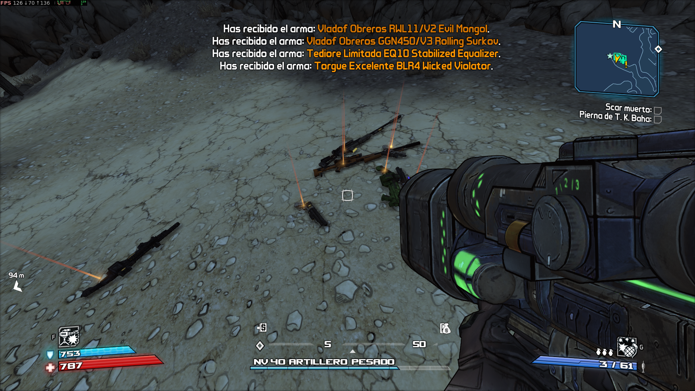

# Lucky Player — Borderlands GOTY Enhanced

**[English](#english) · [Español](#español)**



---

## English

A mod for **Borderlands Game of the Year Enhanced** made with the [willow1 Python SDK](https://github.com/bl-sdk/willow1-mod-manager).

### Features
- **Guaranteed legendary from bosses:** every boss drops one orange weapon, on top of its normal loot.
- **Legendary from weapon chests:** every chest that contains weapons drops one orange weapon on top of it.
- **Speed multiplier:** 1x to 3x (default 2x).
- **Jump multiplier:** 1x to 3x (default 3x).
- **Mission XP multiplier:** 0.1x to 5x (default 5x).
- **General XP multiplier:** everything except missions (kills, etc.), 1x to 10x (default 1x).

All options are in the in-game **Mods** menu (option names are in Spanish).

### Installation
1. Install the [willow1 SDK for BL1 Enhanced](https://bl-sdk.github.io/willow1-mod-db/) (v2.3 or newer).
2. Copy `LuckyPlayer.sdkmod` into the game's `sdk_mods` folder.
3. Start the game, open **Mods** and enable **Lucky Player**.

**Linux / Steam Deck (Proton):** add this launch option in Steam:
```
WINEDLLOVERRIDES="dinput8=n,b" %command% -pf_tricks=vcrun2022
```

### Notes
- Offline / single-player use recommended.
- Uninstall: delete `LuckyPlayer.sdkmod`. Your save is not modified by the mod itself, but anything you picked up stays in it.

---

## Español

Mod para **Borderlands Game of the Year Enhanced** hecho con el [SDK de Python willow1](https://github.com/bl-sdk/willow1-mod-manager).

### Qué hace
- **Legendaria asegurada de jefes:** cada jefe suelta un arma naranja, además de su botín normal.
- **Legendaria en cofres con armas:** cada cofre que trae armas suelta un arma naranja encima.
- **Multiplicador de velocidad:** de 1x a 3x (viene en 2x).
- **Multiplicador de salto:** de 1x a 3x (viene en 3x).
- **Experiencia recibida por misión:** de 0,1x a 5x (viene en 5x).
- **Multiplicador de experiencia en general:** todo menos misiones (matar, etc.), de 1x a 10x (viene en 1x).

Todo se ajusta desde el menú **Mods** dentro del juego.

### Instalación
1. Instala el [SDK willow1 para BL1 Enhanced](https://bl-sdk.github.io/willow1-mod-db/) (v2.3 o superior).
2. Copia `LuckyPlayer.sdkmod` en la carpeta `sdk_mods` del juego.
3. Abre el juego, entra a **Mods** y activa **Lucky Player**.

**Linux / Steam Deck (Proton):** agrega esta opción de lanzamiento en Steam:
```
WINEDLLOVERRIDES="dinput8=n,b" %command% -pf_tricks=vcrun2022
```

### Notas
- Recomendado para jugar sin conexión / un jugador.
- Desinstalar: borra `LuckyPlayer.sdkmod`. El mod no modifica tu partida por sí mismo, pero lo que recojas se queda en ella.

---

MIT License © 2026 Angel
